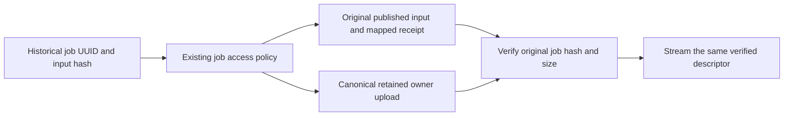

# Additive record imports and retained delivery files

Initial research and implementation: 21 October 2026. The central transfer package
plans additions to an occupied current-model database. This is separate from
native PostgreSQL recovery, which restores a complete copy into another empty
database. This document records the design, its code evidence and its limits;
the [administrator instructions](../user-guide/record-transfers.md) describe use.

The 23 October extension adds explicit records-only/available-files choices and
durable expected artifact references in the existing receipts. New portable
format 3 carries a semantic schema descriptor and supported-reader version;
formats 1/2 keep their strict readers. Missing bytes are historical availability,
not permission to skip integrity checks on an included payload. Complete native
PostgreSQL backups can additionally preserve retained local files, including
unlinked ZIPs, through a separate schema-independent inventory. See the
[database and storage lifecycle](database-storage-lifecycle.md) implementation
update for current capabilities and the remaining proposed registry/operations.

## Findings that determine the design

The original application importer assumed empty business tables, inserted source
primary keys and compared the entire destination with the incoming graph.
Removing its empty-table check would have collided with existing identities,
broken relationships and invalidated immutable submission evidence. The audit
also found that historical job pages downloaded the current upload by owner and
filename, without checking that run's input hash.

Three detailed audits cover the original implementation and the requirements:

- [Record identities and dependencies](additive-import-audits/identity-audit.md): all twelve business resources, account identities, SQL/domain uniqueness, review history and readiness evidence.
- [Retained ZIP and storage evidence](additive-import-audits/storage-audit.md): shared volumes, safe path resolution, published manifests, retained work directories and file verification.
- [Admin workflow and acceptance cases](additive-import-audits/ux-audit.md): existing UI patterns, conflict decisions, dependency exclusions and test scenarios.

Those appendices describe the **pre-change baseline and design investigation**.
The following sections describe the resulting implementation.

## One transfer service, distinct profile contracts

**Maintenance → Back up & restore** (`/admin/maintenance/backups/`) owns one
complete native backup builder and restoration of native or supported historical
portable packages. The Database direction owns identity/schema previews and table
browsing; Maintenance owns pause controls and recovery. Historical account and
application profiles retain their distinct import contracts. These areas share
one transfer service:

| Operation | Purpose | Existing information |
| --- | --- | --- |
| User profiles | Select profiles independently of QC history | Create inactive users, reuse existing identities, skip users, or explicitly update only first name, last name and email |
| Database records | Add the supported connected application graph, with explicit account mapping and conflict review | Existing rows and files are unchanged; conflicting incoming branches can be excluded |
| Full database backup and restore | Preserve every PostgreSQL table/field, including authentication and framework records | Restore into a separate empty database; activation and same-window rollback are separate reviewed actions |

The application import does not execute SQL supplied in a package. A native
`pg_dump` archive cannot be used as an arbitrary row merge: PostgreSQL restore
reconstructs archived database objects and data, while application identity and
review decisions require domain rules. See the primary documentation for
[pg_dump](https://www.postgresql.org/docs/14/app-pgdump.html) and
[pg_restore](https://www.postgresql.org/docs/14/app-pgrestore.html).

Portable records retain the existing explicit field contract. Password hashes,
API credential digests, sessions, service credentials and automatic access
grants remain excluded from this profile. **Use the full native backup for
complete PostgreSQL fidelity.** Existing accounts never receive an incoming
password, token, role or permission through a mapping. New portable accounts
are inactive with unusable passwords until locally reviewed. Raw passwords and
already-issued API secrets cannot be reconstructed from their stored hashes.

Application exports include the user profiles required by included foreign keys,
including delivery owners, job requesters, approvers and reviewers. Unrelated
accounts are excluded. Administrators export selected or all unrelated profiles
through **Users** instead. The application scope remains the complete supported
QC graph, not an arbitrary selection of PostgreSQL tables.

## User profiles are a separate portable operation

[`account_import.py`](../../src/qc_tool/database/transfers/account_import.py)
owns user-only planning, execution and receipt verification. Typed source-key
decisions are `import`, `reuse`, `replace` and `skip`. The UI displays `replace`
as **Update profile** and shows all three incoming/current profile fields.
It requires an explicit matching-username target and updates only first name,
last name and email. Username, PK, join date, credentials, activation, account
privileges, roles, permissions, product grants, tokens, sessions and existing QC
history remain unchanged. Reuse changes nothing; a new user is inactive with an
unusable password. Skipping does not delete any existing user. An all-skipped
selection is blocked.

These decisions are not available for application-graph or native imports.
Application mappings establish ownership while keeping the destination account
unchanged. User-profile updates do not weaken the graph import's insert-only
contract.

## Identity and conflict rules

[`merge.py`](../../src/qc_tool/database/transfers/merge.py) owns the insert-only
planner and verifier. Views submit enumerated decisions to the existing
[`service.py`](../../src/qc_tool/database/transfers/service.py) facade.

1. Validate the complete incoming field contract, foreign-key closure, uniqueness,
   terminal job state, immutable specification bytes and publication inventory.
2. Map accounts explicitly. A matching username/email is a suggestion, not an
   ownership decision. Application mappings retain the username used in storage.
3. Prefer previously committed source identities. Otherwise use reviewed domain
   keys for catalog resources and UUIDs for jobs/submissions. An incoming integer
   PK is never treated as an unrelated destination PK.
4. Allocate new integer identities and translate **all** included relationships.
   Keep job/submission UUIDs stable.
5. Reuse exact matches. If immutable catalog content agrees but local catalog
   state or timestamps differ, show the differences and offer explicit reuse of
   the existing row. Its values stay unchanged; original incoming differences
   remain in the private receipt.
6. Conflicting job UUIDs, independent review histories, a second accepted
   submission or incompatible release content cannot overwrite the incumbent.
   Exclude the incoming branch or resolve its domain conflict separately.
7. Exclusion follows dependency closure, including release-definition links and
   complete review/conflict event histories. The UI shows the affected counts.
   Revalidate the selected graph before enabling confirmation.

Deliveries have no unique filename or natural SQL identity. Repeated files can
represent different upload events. New deliveries receive new PKs; provenance
prevents later packages from recreating an event already imported. Same filename,
size or hash alone never assigns an incoming event to another user's history.
Remote-source rows are created without credentials rather than automatically
sharing another row's live credentials.

Current destination approvals and readiness are preserved. New products do not
inherit a readiness assertion computed for another database scope; original
source facts are retained for audit. Adding accepted history can make an existing
scope confirmation stale, which the existing readiness checks must reevaluate.

## Durable provenance without changing the schema

[`provenance.py`](../../src/qc_tool/database/transfers/provenance.py) uses the
existing `qc_database_transfer_receipt.summary` JSON field. The receipt and new
rows commit in the **same SQL transaction**. No model, schema or migration is
added by this feature.

- An origin receipt provides a database namespace. Only an actual reviewed
  export allocates one; previews remain read-only. Native copies retain it.
- Version 2 portable application records carry source namespace/key identities
  and original publication context. Re-export keeps imported identities rather
  than inventing new identities from reassigned local PKs.
- Additive receipts record source-to-local maps, create/reuse/skip dispositions,
  original source differences and both original and approved local publication
  contexts. A later read must still match that approved local relationship.
- Original differing catalog metadata also travels in typed, audit-only source
  records on re-export. It is not applied as an overwrite or used as access authority.
- Original manifests and specification files remain byte-for-byte unchanged.
  Their embedded source IDs are verified through the recorded translation,
  rather than silently rewritten or ignored.
- Version 1 remains readable. It lacks an installation namespace, so identical
  legacy graphs receive a deterministic identity; changed legacy exports do
  not have the same cross-package identity guarantee as version 2.

The ledger is bounded and validated; it fails closed rather than truncating
identity evidence. It currently supports 10,000 additive receipts and 1,000,000
identity bindings. The existing portable package, archive, private journal and
free-space limits also apply. Target verification streams row digests and has
a one-million-row bound, including account access and permission evidence.
A future indexed ledger requires a separately
reviewed persistence change; it is not prebuilt migration machinery.

## Historical job to exact ZIP

The job result page now uses `job_input_zip`, a job-bound download route governed
by `require_job_view`. It prefers verified immutable submission input and can
fall back to the configured owner's canonical retained upload. The source file
must match that job's recorded input checksum. Existing server ZIPs can be reused
without overwriting or re-uploading them through the application.

A filename match never proves historical identity. Missing original hashes or
bytes result in an unavailable historical download, rather than a link serving a
different current file. The review distinguishes packaged ZIPs, verified retained
ZIPs, missing/different files, deleted history and unverified historical runs.
It never accepts arbitrary filesystem paths or scans unrestricted server storage.

Safe existing files are reused. Exclusive creation and the existing owned-file
journal handle new files. Additive imports retain immutable specification
versions but do not activate source specification pointers or boundary settings.
Published trees remain strictly inventory-verified; safe unrelated runtime logs
and scratch data in retained job work directories do not invalidate the import.
Separate external writers must also respect storage isolation; checksum checking
does not make an independently mutable filesystem an immutable backup.

## Concurrency, recovery and compatibility

The existing maintenance generation, activity barrier, durable transfer pin and
execution lease serialize import with QC writers and other transfers. Final
application uses PostgreSQL table locks, rechecks the complete target evidence,
then inserts additions and the receipt atomically. The lock permits ordinary
reads while excluding competing data writes; see PostgreSQL's
[explicit locking rules](https://www.postgresql.org/docs/14/explicit-locking.html).
`ON CONFLICT DO UPDATE` is deliberately not a substitute for the domain plan.

Saving decisions also checks `expected_plan_hash` against the current stored
plan under the execution lock. An older page cannot overwrite choices saved by
another administrator between the view's initial read and service execution.
Saved user choices remain in the core operation plan across pagination,
revalidation, admission and execution. User imports lock authentication and
receipt tables before checking that exact plan, apply only the allowed profile
fields, and commit their decision/count evidence in the same receipt transaction.
Recovery verifies committed choices, mapped identities, separate
created/updated/reused counts and private authentication evidence; it does not
repeat committed profile updates.

Target evidence includes values rather than only counts, so edits with unchanged
row counts invalidate review. Verification checks the imported subset and the
pre-existing records, instead of comparing the whole target to the source.
Filesystem publication and SQL are not one transaction; the existing receipt,
owned-file journal and held maintenance pin reconcile interrupted operations.
This also respects Django's distinction between SQL atomicity and external
effects in its [transaction documentation](https://docs.djangoproject.com/en/5.2/topics/db/transactions/).

The current portable reader still requires the exact supported model contract.
A release number such as v3.1.0 alone does not establish compatibility. Future
contract changes need a reviewed data reader and fixtures proving field/history
preservation. Unsupported drift is blocked with an explanation, never defaulted
or discarded. Native backup remains available for preserving unsupported source
schemas. The v3.0.0 models-only initialization policy remains unchanged.

## Administrator workflow

Choose **Users** or **Database records**, then Import or Export. Users export
offers all profiles or a searchable selection; records export has a fixed
connected-graph scope. Upload identifies the package's type and explains a move
to another area before any import. Review uses existing Admin cards, native
forms, comparison tables, pagination, maintenance notices and theme variables.
There is no arbitrary JSON editor or force-overwrite option.

Users import reviews profile comparisons and create/reuse/update/skip choices.
Records import reviews ownership mappings, record conflicts and original ZIPs.
**Save choices and review** validates the decisions together before destination
confirmation and **Import selected users** or **Add records**. Unsaved changes
cannot bypass server review. Completion separates created, reused, updated and
skipped user counts; graph results retain resource counts and destination job
links. Native restore, explicit switch review and rollback remain secondary
recovery tasks.

Current scope exports the complete supported connected QC graph with its account
dependencies, or selected/all account profiles. Per-delivery/job export selection,
automatic schema conversion, arbitrary raw-dump merging, remote object migration
and arbitrary owner renaming are not implemented. They require their own
dependency/storage contracts.

## Verification

The following historical results were recorded for the 21 October 2026
implementation using disposable Django test databases and isolated test storage.
They are not a validation claim for later Users/UI changes:

| Check | Result |
| --- | --- |
| Database, accounts and dashboard suites on SQLite | 1,263 tests; passed, 37 environment-specific skips |
| Database suite and transfer/download UI on PostgreSQL 14 | 369 tests passed |
| Final focused PostgreSQL regression run after storage/provenance changes | 182 tests passed |
| Dashboard JavaScript suites | 128 tests passed |
| Final transfer UI checks | 76 tests passed; desktop/mobile layouts inspected in light and dark themes using isolated fixtures |

The integration cases include an occupied target with colliding integer IDs,
unchanged existing accounts/permissions/review history, wrong retained ZIP/report
conflict exclusion, actual authorized HTTP delivery of the imported job's exact
ZIP, unchanged manifest bytes, re-export and repeat import without duplication,
and failures before/after commit with receipt-based recovery. SQL/ownership tests
also cover same-count target edits and group/product-access changes.

These checks establish the tested application behavior, not a production restore
rehearsal or automatic compatibility with a future schema. Deployment should
retain the existing backup/storage procedures and supported-contract checks.
