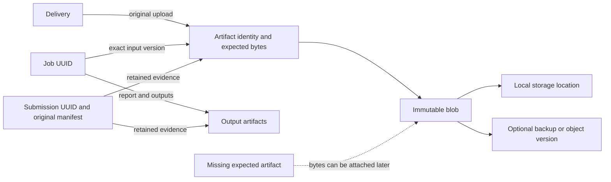

# Database records, files and recovery

Architecture proposal, 23 October 2026. This describes recommended behavior,
including functionality that is **not implemented**. It does not authorize an
in-place schema change, storage move, deletion or production deployment.

## Implementation update

The first implementation extends the existing transfer service with records-only
and records-with-available-files packages, a validated artifact-reference ledger
in existing atomic SQL receipts, semantic portable format 3, source/target schema
comparison, original-package retention on unsupported contracts, and optional
retained local files alongside a complete native PostgreSQL backup. The Admin
Database page checks model readiness on each authorized visit. Legacy portable
formats retain their strict readers. No schema or first-party migration was added.

The dedicated artifact/blob/location tables, unrestricted file-attachment wizard,
selective per-job graph export, object-store copying, scheduled production backup
service and coordinated independent database/storage pointer are still proposed.
Current attachment/reuse is limited to the existing confined canonical paths and
verified immutable publication inputs. Native file restoration is create-only;
specification bytes and legacy boundaries are retained in immutable namespaces
without selecting source activation pointers. Durable restore pins protect files
needed by inactive retained databases from Storage Admin cleanup. The following sections keep the
complete target architecture and distinguish those later capabilities.

## Recommended direction

Treat a delivery or job's **identity**, its **expected files**, and the files'
**current locations** as separate things. Preserve those relationships even
when no bytes are available. Import adds history and links; it does not replace
the current database, infer approval or restart imported jobs.

Give the administrator two ordinary transfer choices:

1. **Records only** — connected records and the complete file-reference manifest;
   no artifact payloads. Existing verified server files can still be linked.
2. **Records and files** — the same records and reference manifest, plus selected
   verified artifact payloads.

Keep **Complete recovery backup** as a separate operation because it restores
an installation rather than appending records. It must coordinate native
PostgreSQL backup, storage and recovery configuration under one recovery-set ID.

The durable promise is that missing bytes do not erase their recorded identity,
relationships or history. Recoverability of the bytes additionally requires
retention, independent backups and restore verification. Database references
alone cannot recover an externally deleted ZIP.

## What the current code already provides

| Capability | Current implementation and limitation |
| --- | --- |
| Connected record contracts | [`transfers/records.py`](../../src/qc_tool/database/transfers/records.py) explicitly accounts for the twelve business resources and their fields, with declared runtime/credential exclusions. It exports the complete supported graph, not selected jobs or arbitrary tables. |
| Additive import | [`transfers/merge.py`](../../src/qc_tool/database/transfers/merge.py) allocates local integer IDs, preserves job/submission UUIDs, resolves dependencies, reuses compatible identities and excludes conflicting branches. Existing business rows are not overwritten. |
| Stable import provenance | [`transfers/provenance.py`](../../src/qc_tool/database/transfers/provenance.py) and [`TransferReceipt`](../../src/qc_tool/database/models.py) retain source namespaces, ID translations and original publication context across re-export. |
| Exact historical input | [`artifacts/inputs.py`](../../src/qc_tool/frontend/dashboard/services/artifacts/inputs.py) checks a job's input hash against its retained publication input or canonical upload. A matching filename alone cannot establish the historical link. |
| Immutable evidence | Published manifests, input hashes and specification bytes are retained. Imported integer IDs are translated in provenance; original documents are not rewritten. |
| File/SQL crash recovery | [`transfers/service.py`](../../src/qc_tool/database/transfers/service.py), [`artifacts.py`](../../src/qc_tool/database/transfers/artifacts.py) and the private operation store coordinate maintenance, exclusive file publication, a filesystem journal and a receipt committed with SQL rows. |
| Protected storage administration | [`storage_admin/references.py`](../../src/qc_tool/frontend/dashboard/services/storage_admin/references.py) protects linked paths; [`trash.py`](../../src/qc_tool/frontend/dashboard/services/storage_admin/trash.py) provides journaled quarantine for eligible unreferenced files. |
| Native database preservation | [`transfers/postgres.py`](../../src/qc_tool/database/transfers/postgres.py) preserves database schema/data, sequences and large objects. The current native backup excludes external files and deployment secrets. |

**Important gaps:** the records UI currently offers “QC records and delivery
files” only. Active local ZIPs, original specification versions and complete
published inventories are required by the portable artifact contract. Missing
job working artifacts may be warnings. There is no general artifact/location
registry, records-only profile, arbitrary legacy-file attachment, file repair
package, selective job export or future-schema conversion reader.

These are contract changes, not reasons to disable existing checksum or
publication checks. The existing [additive import design](additive-record-import.md)
remains the description of implemented behavior.

## Identities and relationships

Use the following conceptual model. Names below are proposals, not new tables
introduced by this document.

| Concept | Identity and retained information |
| --- | --- |
| Business record | Stable source namespace + resource + source identity, local PK mapping, source revision digest. Keep existing job/submission UUIDs. A source integer PK is never assumed to be a destination PK. |
| Artifact | Stable UUID for the logical file/version; role, original filename, provenance and expected full-file SHA-256/size when historically known. Its identity survives missing files or storage relocation. |
| Blob | Immutable exact bytes, identified by digest algorithm + full-file digest + byte count. Distinct upload events can share bytes without becoming the same event. |
| Location | A configured backend ID and confined relative key, plus remote object version where supported. Record observations such as last verification, missing, inaccessible or corrupt. An absolute host path is not a portable identity. |
| Domain association | Typed links such as delivery → original ZIP, job → exact input/report, submission → published inventory, definition → original specification, and job → boundary generation. |
| Storage inventory item | A discovered server file with no proven domain association yet. Retain observed bytes/locator and restricted administrative visibility without inventing a job or owner. |

Use real foreign keys and uniqueness constraints for the supported domain links,
with protected deletion of retained evidence. Avoid a generic table-name/PK
string as the only integrity mechanism. One upload has a delivery link before
any job exists; a job is not a prerequisite for preserving an uploaded file.
Files retained from an older installation start as inventory items until their
relationships can be established.

Do not bind storage ownership to mutable usernames or filenames in the eventual
managed layout. New immutable blob keys can use digest-based paths on the
existing filesystem; adopting S3 is optional. Keep display filenames and access
rights on domain associations. Sharing bytes never shares permissions. Avoid
hard-linking managed immutable evidence to externally writable legacy files;
verified copies into managed storage are safer when immutability is uncertain.

A restored clone initially retains record origins. If it becomes an independent
writer, newly created records need a distinct local origin namespace while
existing record origins remain unchanged. Before changing the writer namespace,
persist the original origin binding of every pre-fork local record: current
provenance derives previously unbound local origins lazily from the namespace.
Rotating that namespace alone would relabel old records. This requires a reviewed
fork operation; silently replacing namespaces or allowing divergent copies to
mint indistinguishable integer identities breaks round trips.

## Keep three independent states

| State dimension | Examples | Effect |
| --- | --- | --- |
| Business history | Uploaded, QC failed, QC passed, submitted, awaiting review, approved, rejected, superseded | Describes the workflow; never inferred from file presence or import success. |
| Local availability and verification | Verified, missing, verification pending, legacy identity unknown, corrupt, inaccessible remote object, quarantined, intentionally purged | Determines whether download, QC rerun or publication can use the bytes. |
| Transfer inclusion | Payload included, deliberately excluded, unavailable at source, external reference only | Explains exactly what this package transports. Excluded is not equivalent to missing at source. |

“The source approved this submission” and “this installation has verified all
of its publication evidence” are different assertions. Preserve the original
review history even if files are missing, while showing **Historical approval;
files unavailable**. Do not serve a partial publication as a verified complete
publication or treat it as ready for new approval/rerun.

For new actions, required inputs/specifications/boundaries must be verified and
available. Browsing historical records remains possible. No placeholder file,
fabricated checksum, manufactured successful QC result or changed review state
should conceal an absence. Missing specifications cannot be recreated by
rewriting their stored JSON representation.

## Which records and files to preserve

Recommended default: **All selected history**, regardless of approval, with
**All retained evidence** when file payloads are requested. Every excluded
category and unavailable file appears in the export review and saved manifest.

| Information | Default treatment | Special rule |
| --- | --- | --- |
| Uploaded ZIP, never run through QC | Include records and retained original ZIP | Does not need a job, successful QC or approval. |
| Failed, cancelled or interrupted QC history | Preserve recorded history and available durable outputs | Do not auto-resume a process, replay a queue claim or label partial output complete. Current portable readers accept terminal job history only. |
| Successful jobs and reports | Include exact input association, results, report and durable attachments | Preserve every selected run, including older runs of a replaced delivery. |
| Submitted, awaiting review | Include upload, selected jobs, immutable publication evidence and review history | Submission is not approval. |
| Approved | Same preservation rules | Approval is a filter, never a substitute for checksum/inventory verification. |
| Rejected, competing, superseded or deleted history | Include historical records and retained evidence | Retain tombstones/deletion decisions; do not resurrect deleted operational state. |
| Catalog, release, unit and QC definitions | Include dependency closure and exact specification version references | Preserve original bytes and source digests; do not activate imported configuration automatically. |
| Boundary generations used by a job | Include exact generation references and available payloads | Distinguish available current boundaries from the historical generation actually used. Unknown historical identity remains unknown. |
| Remote S3 inputs | Include immutable object reference/version and expected hash if known | Remote copying is explicit; inaccessible objects remain visible. Do not claim they were backed up or import source credentials silently. |
| Legacy server ZIPs with no database match | Inventory separately; optionally include in complete recovery backup | Expose **Unlinked files**, not “safe to delete”. Do not fabricate ownership from path/hash. |
| Diagnostic logs | Optional, explicit category | Preserve useful diagnostic evidence when selected; logs may contain secrets and require restricted access. Current portable exports omit log/stdout/scratch classes. |
| Partial uploads and scratch/unpacked inputs | Exclude from normal record transfers, report category | Give temporary operation IDs, expiry and cleanup policy. Complete recovery records how interrupted work is handled; transient data is not automatically runnable. |
| Users, groups, grants and credential data | User-profile transfer and full recovery have different authority rules | Portable account mapping cannot grant source privileges or replace existing passwords/tokens. Complete native recovery preserves stored credential fields. |
| Transfer receipts, original evidence and durable operation journals | Retain as audit/recovery metadata | Old operations cannot become executable authority merely because they were imported/restored. |
| Deployment configuration and encryption keys | Protected recovery channel, separate from ordinary record packages | Record required key IDs/config versions; keep usable key escrow separate from encrypted archives and test restoration. |

Maintain an explicit coverage register for every SQL table and stored field:
portable business data, account/security authority, runtime state or native-only
content, with the preservation policy displayed in review. New fields/tables
must fail the portable coverage check until reviewed. Complete native recovery
preserves SQL content outside the portable contract; do not call an application
package a complete PostgreSQL export. Operational credentials, claims, sessions
and locks restored as data still need local activation/recovery rules.

A full server-preservation claim must inventory additional files, unknown files,
remote objects and exclusions. A portable business package is not a byte-for-byte
copy of every Docker volume. Never advertise silent omissions as “full”.

## Export experience

In **Admin → Database → Export records**, use a short sequential flow:

1. **Choose records**: all maintained QC records by default; future selectors
   may choose products, deliveries/jobs, owners or dates. Display dependency
   expansion before confirmation. An approved-only filter applies to root
   selection; necessary parents, review history and conflict events still travel.
2. **Include files?**: **Records only** or **Records and files**. The latter
   defaults to all retained evidence. Optional categories appear under
   **Choose files**; never require approval to preserve a raw upload.
3. **Review export**: record counts, automatically included dependencies, file
   counts/bytes, already missing files, remote requirements, deliberately
   excluded files, credentials policy and destination capacity.
4. **Create export**: show progress and a downloadable manifest/summary alongside
   the package. Long jobs survive browser navigation through the existing runner.

For example: “1,240 records; 48 files included; 7 unavailable; 2 remote files
not copied.” Offer **Require every selected file** for transfers intended to be
complete. With it off, missing bytes are acknowledged warnings and references
are preserved. With it on, absence blocks completion. A payload claimed included
but absent or corrupt is always an invalid package, regardless of this choice.

Package preview and dry-run do not change domain data or active configuration.
If source data changes during review, refresh the plan rather than silently
exporting a different selection. Bound package/file counts, expanded size and
disk use; provide a segmented payload format for volumes that outgrow one ZIP.

## Package contract

Reuse the current transfer archive and versioned readers. Extend their contract
deliberately instead of introducing an unrelated importer or relaxing the old
reader's required files. Separate small required package metadata from optional
artifact payloads.

Every package should retain:

- Package ID, format/record-contract versions, creation time, producer release,
  source namespace and exact selection/dependency closure.
- Complete source records within that contract, stable origins, original source
  revisions and explicit mappings when re-exporting imported records.
- An artifact reference inventory: stable ID, domain links/role, expected
  SHA-256/size where known, original filename, source locator/version, original
  evidence context and the inclusion reason for each payload. Retain useful
  observed file timestamps/media metadata as provenance; apply destination access
  policy rather than copying source filesystem permissions as authority.
- Original publication manifests and specification evidence metadata/digests;
  byte-for-byte evidence documents when available and allowed by the chosen
  profile. Absent originals are declared, never regenerated and called original.
- A payload inventory with the actual included members, their sizes and hashes;
  archive/member/path validation must match it exactly.
- Explicit exclusions, missing-at-source observations, remote requirements,
  compatibility requirements and the export's consistency checkpoint.

An empty artifact payload inventory can be a valid records-only package. A
nonempty inventory with a missing member is damaged. The inventory distinguishes
intentional absence from transport loss. This is consistent with the separation
of package completeness and checksum validity in [BagIt, RFC 8493](https://www.rfc-editor.org/rfc/rfc8493.html);
adopting the entire BagIt format is unnecessary.

Checksums detect changed bytes; they do not prove who supplied the package, who
owns a file or whether QC passed. Use a trusted administrative source and, for
automated interchange, authenticated signing/verification with an explicit
trust policy. Encrypt sensitive packages using maintained tooling; do not rely
on plain ZIP packaging or database field encryption to protect all metadata.

## Import experience and conflict rules

Use one flow: **Upload package → Review records → Review files → Confirm →
Import summary**. Detect whether it is an append package or recovery backup
before presenting a destination. A SQL dump must not accidentally enter the
append path.

Default to **Add new records and reuse verified existing matches**. Present
new records, exact matches, unresolved conflicts and excluded dependent records
in separate counts. Let safe choices apply to a displayed group; avoid a
universal “replace everything” button. Persist decisions so navigation and a
lost browser connection do not discard them.

| Case | Safe default and available decision |
| --- | --- |
| Source PK exists locally but belongs to another record | Allocate a new local PK and translate every included relationship through provenance. |
| Same source identity and unchanged revision | Reuse the local mapping; verify it still describes the actual row. Do not create a duplicate. |
| Same origin, changed record revision | Show differences. Keep existing or skip incoming; only explicitly supported mutable fields may have a reviewed update policy. Preserve source revision evidence. |
| Same UUID with contradictory job/submission history | Block or exclude its incoming dependency branch. No automatic overwrite, UUID regeneration or history splice. |
| Same artifact identity with different expected content | Block as an identity conflict. A legitimate new file revision receives a new artifact/version identity and explicit relationship; do not replace historical expectations. |
| Same username/email | Ask to reuse the reviewed account, create a distinct inactive identity where supported, or skip. Email/name alone does not prove ownership. Storage links follow the approved identity mapping. |
| New approved history conflicts with an already accepted unit | Preserve existing accepted history. Block/exclude the incoming branch until a separately supported, audited domain decision can retain both histories. Never silently downgrade or supersede either. |
| Exact expected bytes already exist locally | Reuse after checksum, size and authorized relationship/provenance validation. Do not take rollback ownership of pre-existing files. |
| Same filename/path, different bytes | Never overwrite. Show both identities; a future managed artifact layout can retain a separate immutable version. Existing canonical-path conflicts remain blockers until that resolver exists. |
| Expected file is absent; package contains matching bytes | Stage, verify and publish safely; link through the planned identities. |
| File absent from package and server | Import history with a persistent unavailable reference after acknowledgement. Disable only the dependent download/rerun/publication actions. |
| Records-only package; matching old server file exists | Link only through expected hash/size plus reviewed domain context. Preserve its existing location or adopt a verified managed copy. |
| Candidate has no trustworthy historical checksum/inventory | Offer **Keep unverified**. An administrator's assertion may be recorded, but it cannot become cryptographic proof of a past job's input. |
| Remote source cannot be read or has changed | Preserve expected remote identity and show inaccessible/mismatch; do not fetch arbitrary hosts or provision source credentials implicitly. |
| Payload hash fails, member is missing, path is unsafe or archive is malformed | Reject the package. “Allow missing source files” must never bypass payload integrity/security validation. |
| Same package retried after lost acknowledgement | Find its committed receipt, verify the result and return/recover it without reapplying updates or duplicating records. |
| A previously excluded branch is wanted later | Use an explicitly derived new package/selection with stable origins; existing package receipts are not silently rewritten to change committed scope. |

Make user updates a separate bounded decision. For future mutable metadata
updates, a three-way comparison (last imported source revision, current local,
incoming) can identify concurrent edits, but that is a new reviewed policy.
Preserve the current append-only graph behavior until it exists. Publication
identity, audit events and historical evidence do not become editable fields.

The import summary must distinguish **created**, **reused**, **updated** where
supported, **skipped**, **linked files**, **copied files**, **unavailable** and
**unverified**. Provide a **Review unavailable files** action inside Admin;
successful record import must not imply that every artifact was restored.

## Later file attachment and old storage

Provide **Admin → Storage** views for **Linked files**, **Missing files**,
**Unlinked files**, **Verification problems**, and **Trash**. Existing browse,
download, reference checks and quarantine services are the starting point.

**Find matching files** should inspect only configured authorized roots, build a
bounded/resumable inventory, and propose candidates using size/hash. Do not scan
arbitrary server paths. Recheck bytes and context when applying the association;
a cached scan or filename is insufficient. Frontend and worker access must both
be checked where operational reruns are requested.

Importing records into an empty database must not cause pre-existing server
files to be deleted or assigned to the first matching user. Scan them as
unlinked inventory, resolve ownership/provenance explicitly, then link verified
matches. Record-only import can therefore happen before or after storage copy.

Add a future **Attach missing files** operation, also usable with a repair
package. It supplies artifact identities/checksums and bytes for existing
references without replaying their database history. It must be idempotent,
preserve original manifests and record who established the association.

Retain historical expected hashes separately from newly observed candidate
hashes. Computing a candidate's hash today must not fill a missing historical
`Job.input_sha256` as if the past job verified those bytes. Independently validated
original job-bound evidence can establish that fact; retain its source and
verification method. An administrator assertion alone remains an assertion.

A scheduled integrity check compares expected references to storage, reporting
missing, extra, inaccessible and corrupt objects. Update observations rather
than deleting records. Expensive hashing runs as bounded background work; reads
must not trust stale verification of files that an external writer can mutate.

## Durable execution, concurrency and deletion

Keep the existing maintenance generation, writer barrier, transfer lease, plan
hash, filesystem journal and atomic SQL receipt. Large file copy/hash work stays
outside short SQL transactions. Recheck the reviewed database and storage
identities at apply time; two administrator tabs must not apply stale choices.

For imports, retain the existing pattern: privately stage/verify bytes, journal
exclusive publication, publish durable files, then commit records, associations
and receipt together. Files appear in the application only through authorized
committed associations. On failure, remove only provably operation-created
files when no commit occurred; uncertain outcomes keep maintenance pinned for
receipt-based recovery. Do not delete reused files. Missing-file references
commit normally when the reviewed package permits them.

SQL and filesystem operations are not one transaction. In particular,
[`on_commit()` callbacks](https://docs.djangoproject.com/en/5.2/topics/db/transactions/#timing-of-execution)
run after the database commit, and a failed callback cannot undo it. A callback
alone cannot replace durable staging, journal/receipt recovery and reconciliation.

Treat deletion as a separate workflow:

1. Preview dependencies and retention obligations, including historical jobs,
   publications, active imports, previous switch/rollback databases and retained
   recovery sets. An empty active database is not evidence that a volume is disposable.
2. Prefer deactivation/tombstones for business history and reviewed reversible
   quarantine for eligible unreferenced bytes. No automatic orphan purge.
3. Purge only after an explicit retention decision, grace period and a final
   reference/pin check. Preserve an audit tombstone/reason, subject to approved
   privacy-erasure policy. Never claim bytes remain recoverable after their last
   retained copy was deliberately removed.

A blob shared by two deliveries is not eligible merely because one delivery was
deleted. Recovery sets referencing shared storage pin those blobs; genuinely
self-contained immutable backup copies have independent retention.
If a retained database, recovery inventory or storage pin cannot be inspected,
cleanup is blocked. Missing access is not proof that references no longer exist.

## Coordinated backup, restore and schema evolution

For convenient disaster recovery, add **Create complete recovery backup** with
one recovery-set manifest identifying:

- Native PostgreSQL archive and its schema/data verification evidence.
- Referenced durable artifact bytes and manifest, plus separately inventoried
  unlinked server files when full storage preservation is selected.
- Original specifications, boundary generations, provenance and durable control/
  operation state required to reconcile interrupted work.
- Required configuration, application image digest, PostgreSQL/extensions,
  ownership mapping, storage-root mapping and key IDs. Keep secrets/keys in a
  protected recovery channel; availability must be proved in restore drills.
- Checkpoint, explicit exclusions, hashes, completeness level and successful
  restore-verification evidence. Historical absence can be recorded without
  claiming every historical byte is present.

Start with the supported maintenance barrier: stop admissions, confirm workers
and all application writers have stopped, isolate external PostgreSQL writers
and filesystem/object-storage writers, capture database + file inventory,
copy/verify bytes, and finalize the set only after all promised components are
durable. QC maintenance alone cannot control independently connected SQL clients
or server scripts. A failed worker check is a blocker, not an optional button
to ignore. The UI can automate the application checks.

Portable history exports should require jobs/publications to reach supported
settled states first. An unsettled runtime snapshot can be preserved by native
recovery, but restoring it must not automatically resume claims, publications
or worker processes. Preserve source state as evidence and require the supported
local recovery procedure before reopening.

PostgreSQL [`pg_dump`](https://www.postgresql.org/docs/14/app-pgdump.html) provides
a consistent database snapshot, but does not capture external artifact storage
or cluster-wide roles/tablespaces. Back up or explicitly provision those globals
separately. Application users/password hashes inside SQL tables are different
from PostgreSQL server login roles. Restore ownership/ACL mapping must be reviewed.

Never copy a running PostgreSQL data directory with ordinary file-copy tooling
and assume maintenance makes it safe. PostgreSQL's
[physical-backup requirements](https://www.postgresql.org/docs/14/backup-file.html)
still apply. Use native logical backup for the UI workflow or supported physical
backup tooling. [`pg_restore`](https://www.postgresql.org/docs/14/app-pgrestore.html)
reconstructs archived database objects; it does not perform QC Tool's identity,
ownership and review-conflict merge.

Restore into a separate empty database and isolated storage namespace first.
Verify SQL relationships, artifact identities/hashes, original evidence,
administrator recovery access and permissions, then explicitly activate the
paired database/storage set. A future combined switch needs one coordinated
selection revision and crash recovery; the current database-only pointer is
insufficient for independently restored storage. Retain the previous pair.
Rollback is confined to the same maintenance window before accepting new work;
later rollback needs another reviewed reconciliation to avoid discarding new work.

For production, define measurable recovery point/time objectives and schedule
independent off-host backups, not just manual UI downloads. A PostgreSQL
[base-backup and WAL archive](https://www.postgresql.org/docs/14/continuous-archiving.html)
can add point-in-time recovery; logical dumps are not its base backups. Retain
matching immutable artifact versions for the recovery horizon: PostgreSQL WAL
alone cannot recover external files. Rehearse restoration into isolated targets
on a schedule and before a major deployment, including old-job downloads and
another export. Never expire the last verified recovery copy by accident.

With optional S3 storage, pin object versions and keep a full-file SHA-256/size;
multipart ETags are not a portable full-file digest. See AWS
[checksum semantics](https://docs.aws.amazon.com/AmazonS3/latest/userguide/checking-object-integrity-upload.html)
and [version retention](https://docs.aws.amazon.com/AmazonS3/latest/userguide/Versioning.html).
Versioning helps recover replacement/deletion but is not an independent tested
backup or a PostgreSQL/storage transaction.

Keep three compatibility questions separate: package contract, QC Tool model
schema, and PostgreSQL engine/tool versions. Publish a supported reader matrix
and field-preservation fixtures. Unknown required fields or relationships block
application; retaining the untouched source package is mandatory when conversion
is unsupported. Original source metadata remains audit-only unless a typed
reader explicitly understands it. No release-number guess, dropped field,
silent default or SQL execution is a schema-conversion strategy.

The current [`draft` database policy](../../src/qc_tool/database/README.md) remains
unchanged. Artifact models would be direct draft-model changes tested on fresh
disposable databases, not tables patched into existing v3.0.0 installations.
Do not introduce baselines/migrations, legacy converters or automatic adoption
for this feature. A migration-managed 3.0.1-or-later release needs its own reviewed
initialization/adoption transition. Package readers do not upgrade target schemas.

## Delivery sequence and acceptance criteria

1. Extend the existing package contract and planner for records-only and explicit
   absent/excluded artifact references. Preserve old strict readers. Separate
   historical record validity from local file readiness throughout download,
   readiness, re-export and conflict handling.
2. Introduce central artifact/location/typed-link ownership and inventory under
   the permitted draft-model workflow. Reuse source provenance, archive safety,
   input verification, operation receipts, journals and existing Admin UI components.
   Keep reusable functionality outside `vector/` and `raster/`.
3. Add the short export/import flows, selective dependency-aware scopes, matching
   candidates and file-attachment repair. Maintain explicit bounds while replacing
   repeated receipt JSON scans with indexed identity ownership when justified.
4. Add coordinated recovery sets, database/storage pair activation, scheduled
   verification and retention-aware cleanup. Test a complete restore before
   advertising complete recovery.

Required acceptance cases include:

| Scenario | Required result |
| --- | --- |
| Records-only into occupied database | Append/reuse reviewed graph; unchanged existing rows/files; every omitted artifact remains described. |
| Records-only into empty database with old ZIPs already mounted | No cleanup/adoption by filename; exact approved matches accessible through imported old jobs. |
| Missing raw ZIP, published input, report, spec or boundary | Import history where permitted; explicit per-artifact availability; no fake evidence or operational readiness. |
| Submitted, rejected, failed and approved examples | Preserve each selected state/history independently of file presence; approval never required for archival export. |
| Same filename with different bytes; same bytes from different owners | No overwrite or permission leakage; separate event identity and correct exact historical inputs. |
| Merge → re-export → reimport in both directions | Stable origins, no duplicate events, unchanged original manifests/specification bytes. |
| Source namespace clone diverges | Contradictory identities detected; new independent writer identities cannot collide. |
| File copied later / repair package repeated | Existing missing references become verified without new jobs or duplicate history. |
| Stale plan, second admin, external file mutation, mount loss or disk exhaustion | Safe refusal/retry; no false completion or removal of existing bytes. |
| Crash before publication, before SQL commit or after lost commit acknowledgement | Idempotent journal/receipt recovery; only proven operation-created uncommitted files eligible for cleanup. |
| Corrupt package, unknown fields/schema, unsafe member or fake provenance | Reject without domain writes; retain trusted source evidence for a supported handoff. |
| Delete/purge with references in historical jobs, retained DBs or recovery sets | Protected until dependencies/retention are resolved; reversible quarantine where allowed. |
| Full recovery followed by actual authenticated downloads | Correct old-job ZIP bytes, reports, access controls, credential recovery, SQL sequences and original evidence verified. |

This proposal was checked against the current source and primary PostgreSQL,
Django, RFC and AWS documentation. No runtime behavior, database, storage,
specification or deployment was changed by this design work.
