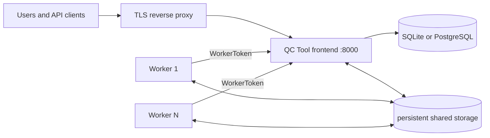

# Deployment

The files under `docker/` are deployment baselines, not universal production
manifests. Select a persistence profile, pin reviewed image digests, provide
secrets, adapt hostnames/origins, and put the frontend behind a correctly
configured HTTPS reverse proxy.

EEA's existing release flow uses GitHub tags to trigger Docker Hub automated
builds for the frontend and worker. Tag an already-reviewed, green commit, verify
both published images, then hand their digests to the EEA deployment. GitHub tag
CI and Docker Hub builds run independently. See [Docker Hub images](dockerhub-images.md)
for the existing build rules, source provenance and artifact checks.

New installations initialize an entirely empty database from current models.
v3.0.0 ships no migration framework, schema snapshots or legacy converter.
Legacy conversion is private manual operator work; restore only a prepared
current-schema artifact into a separate target. Read the
[database guide](../../src/qc_tool/database/README.md) and
[manual restore guide](../../src/qc_tool/database/MANUAL_RESTORE.md) before attaching
persistent storage. For application updates, follow [Operations](operations.md#upgrades).

## Choose a profile

| Profile | Frontend database | Shared storage | Appropriate for |
| --- | --- | --- | --- |
| `docker-compose.service_provider.yml` | SQLite on one named volume | one `qc_tool_volume` | one frontend, simple self-hosted installation |
| `docker-compose.eea.yml` | PostgreSQL 14 | separate DB/boundary/incoming/work/submission volumes | managed installation with external user DB lifecycle |
| EEA + `compose.eea-storage.yaml` | PostgreSQL 14 on a private persistent path | one mounted application tree plus separate private frontend/database folders | Linux Azure VM with operator-managed persistent storage |

For Azure production, follow [EEA persistent storage](eea-storage.md) to mount
and verify the filesystem, configure startup identity checks and expose its real
application folders in Admin's file browser. This optional override preserves
the current container paths and does not move existing named-volume contents.
Use the same base/override file set for every command; the single-file examples
below must be adapted when that profile is selected.

Both profiles support multiple worker replicas. Keep one frontend process and
one frontend container for now: the WSGI module owns a background status-refresh
thread, and the SQLite profile is not suitable for concurrent frontend writers.

## Runtime topology



The production Compose files bind port 8000 to host loopback and do not provide
TLS. Route a trusted HTTPS ingress to that loopback listener. An ingress in
another container should use a private shared network instead of publishing the
frontend to an untrusted network.

## 1. Pin and customize the manifests

Copy the selected Compose file into deployment configuration management, then:

- set `QC_TOOL_FRONTEND_IMAGE` and `QC_TOOL_WORKER_IMAGE` to matching reviewed
  image digests; production profiles refuse to select legacy defaults;
- set the real `DJANGO_ALLOWED_HOSTS` and `CSRF_TRUSTED_ORIGINS`;
- set the public `API_URL` when applicable;
- configure exact HTTPS `S3_ALLOWED_ENDPOINTS`, or leave S3 disabled;
- verify volume names and storage drivers;
- verify `INSPIRE_SERVICE_URL` from inside the worker;
- add the TLS/proxy-specific Django variables described below.

The bundled validator listens on HTTP port 8080 inside its worker. Override and
verify `INSPIRE_SERVICE_URL` when using an external validator.

The normal release process uses the existing tag-triggered Docker Hub builds.
For an isolated manual verification build, package both artifacts from the same
reviewed checkout using the repository root as context. CI tests the packaged
source without bind mounts; builds never download a different application
branch. Supply the release tag as `VERSION` and its reviewed commit SHA as
`SOURCE_REVISION`:

```bash
docker build --build-arg VERSION="$QC_RELEASE_TAG" \
  --build-arg SOURCE_REVISION="$QC_RELEASE_COMMIT" \
  -f docker/Dockerfile.frontend -t "$QC_RELEASE_FRONTEND_TAG" .
docker build --build-arg VERSION="$QC_RELEASE_TAG" \
  --build-arg SOURCE_REVISION="$QC_RELEASE_COMMIT" --build-arg BUILD_JOBS=2 \
  -f docker/Dockerfile.worker -t "$QC_RELEASE_WORKER_TAG" .
```

`VERSION` identifies the release in the UI and QC reports; `SOURCE_REVISION`
records immutable source provenance in the image label. Manual builds that omit
the revision are labelled `unknown` and need a verified source identity before
release. For deployment, record and use the actual Docker Hub digest pair.

The worker uses Ubuntu 24.04/Python 3.12, a private virtual environment and the
reviewed GDAL 3.8.4/Arrow 17/PostgreSQL 17/Java 11 stack. Its build and entrypoint
reject unsupported Python, missing QC drivers or broken application adapters.
The first build compiles GDAL and Squid; budget time and memory rather than
reusing a legacy Python 3.8 worker. `.dockerignore` excludes private database
backups and operator work from the source context.

## 2. Create a secret environment file

Store the file outside the repository with restrictive filesystem permissions.
At minimum:

```dotenv
DJANGO_SECRET_KEY=<long-random-secret>
QC_TOOL_POSTGRES_PASSWORD=<long-random-database-password>
QC_TOOL_FRONTEND_IMAGE=<registry/frontend@sha256:reviewed-digest>
QC_TOOL_WORKER_IMAGE=<registry/worker@sha256:reviewed-digest>
```

Both production profiles require `QC_TOOL_FRONTEND_IMAGE`,
`QC_TOOL_WORKER_IMAGE` and `DJANGO_SECRET_KEY`.
`QC_TOOL_POSTGRES_PASSWORD` is required by the PostgreSQL profile. Do not add it
to a SQLite profile unnecessarily. An env file only supplies substitutions;
the Compose service must explicitly pass each application setting into its
container.

## 3. Configure TLS trust deliberately

Choose one owner for redirects and HSTS: the trusted ingress or Django.

If Django is behind a proxy that **removes any client-supplied forwarding
header and sets its own** `X-Forwarded-Proto`, pass:

```yaml
services:
  frontend:
    environment:
      DJANGO_TRUST_PROXY_SSL_HEADER: "yes"
      DJANGO_SECURE_SSL_REDIRECT: "yes"
      DJANGO_SECURE_HSTS_SECONDS: "31536000"
      DJANGO_SECURE_HSTS_INCLUDE_SUBDOMAINS: "yes"
      DJANGO_SECURE_HSTS_PRELOAD: "no"
```

Do not enable proxy trust when clients can reach Django directly or can control
that header. Enable HSTS subdomains or preload only after confirming every
affected hostname is permanently HTTPS.

Outside development/test, settings fail closed when `DJANGO_SECRET_KEY` is
missing, debug is enabled, or allowed hosts are empty/wildcarded. Secure session
and CSRF cookies default on.

## 4. Validate the rendered configuration

Use one stable project name for initial deployment and every upgrade; Compose
uses it in persistent volume names. For a legacy data cutover, use
a distinct target project and new database volumes so the old deployment stays
available for recovery. The PostgreSQL service uses project-scoped names, so a
separate target can coexist with the retained source. Set a different
`QC_TOOL_PORT` in the target env file when verifying both frontends on one host;
the default loopback listener is port 8000. Define the deployment command once and use it for all
remaining steps. Set these values to the reviewed target environment:

```bash
QC_RELEASE_PROJECT=qc_tool_app
QC_RELEASE_ENV_FILE=/secure/path/qc-tool.env
QC_RELEASE_COMPOSE_FILE=docker/docker-compose.eea.yml

qc_compose() {
  docker compose \
    --project-name "$QC_RELEASE_PROJECT" \
    --env-file "$QC_RELEASE_ENV_FILE" \
    -f "$QC_RELEASE_COMPOSE_FILE" \
    "$@"
}

qc_compose config --quiet
```

Inspect the full rendered configuration as well. Confirm there are no demo-user
or development-server flags and no accidental host bind mounts.

## 5. Pull and initialize the database

Prepare the [release record](../../src/qc_tool/database/releases/3.0.0.md) using
the [template](../../src/qc_tool/database/RELEASE_TEMPLATE.md). Keep frontend and
workers stopped while preparing the target. The explicit initializer supports
an entirely empty production database; it does not upgrade, reset or convert an
existing database. A product catalog with no products is not proof of emptiness.

```bash
qc_compose pull
qc_compose up --detach userdb
qc_compose exec -T userdb pg_isready --username qc_user --dbname qc_tool
```

Wait for `pg_isready` to succeed. The SQLite profile has no `userdb` service;
skip those two commands for that profile and retain its persistent frontend
volume. Inspect the target using the same pinned frontend image that will serve
traffic:

```bash
qc_compose run --rm --no-deps frontend \
  python3 -m qc_tool.frontend.manage database plan
```

`plan` inspects the schema without changing it. For an entirely empty target,
review the reported database identity and initialize it once:

```bash
qc_compose run --rm --no-deps frontend \
  python3 -m qc_tool.frontend.manage database apply --traceback
```

`apply` creates the current-model schema and standard permissions/roles on an
empty database. It is a read-only no-op for a complete matching schema and
refuses partial or foreign schemas and detected model drift. Stop on an error;
preserve the target and restricted logs for investigation. It never repairs existing tables.

For a manual data cutover, use the
[manual restore guide](../../src/qc_tool/database/MANUAL_RESTORE.md) instead of
initializing the restore target. That guide restores a prepared current-schema
artifact into a separate empty database. Do not restore legacy DDL over the
model-created schema. Validate restored records and corresponding storage while
frontend and workers remain stopped.

A new empty installation needs no restore. Its product catalog stays empty until
an administrator uploads reviewed JSON files through **Products → Upload
specification**; bundled recipe directories do not populate products at startup.

```bash
qc_compose run --rm --no-deps frontend \
  python3 -m qc_tool.frontend.manage database check
```

`check` validates the current schema read-only. Continue only after it and the
release's data/storage validation succeed:

```bash
qc_compose up --detach --scale worker=4
```

Production frontend startup runs the read-only schema check and collects static
files before Gunicorn. It refuses an empty or incompatible schema. Use the
explicit initialization job above; `QC_TOOL_INITIALIZE_ON_STARTUP=yes` is reserved
for development/test. Startup does not convert data or apply schema upgrades.

The manifests wait for PostgreSQL and frontend liveness before starting dependent
services and use a child-reaping init process for detached transfer runners.
Health checks continue during maintenance. `/health` certifies liveness only;
`database check`, maintenance readiness and restore validation remain separate
checks. Docker marks unhealthy containers but does not automatically restart
them; monitoring must alert or replace the complete affected container.

## 6. Verify

```bash
qc_compose ps

qc_compose exec frontend python3 -m qc_tool.frontend.manage check --deploy --fail-level WARNING
```

Review every reported item. If the trusted ingress—not Django—owns SSL redirect
or HSTS, document that control rather than enabling conflicting Django settings
merely to silence a check. No other warning should be accepted without an
explicit risk decision.

Record the initialization/restore result and the following checks in the release record.
Verify through the public HTTPS hostname:

- login renders and POST login works;
- static assets load;
- HTTP redirects to HTTPS when that is the chosen topology;
- session and CSRF cookies are Secure;
- logout is a CSRF-protected POST;
- API documentation loads without a credential;
- private endpoints reject anonymous users;
- worker and database are healthy.

## 7. Bootstrap administration and boundaries

Create the first superuser interactively:

```bash
qc_compose exec frontend python3 -m qc_tool.frontend.manage createsuperuser
```

Sign in, create named operator accounts, and use **Admin → Boundaries** to
activate an operator-supplied boundary package before the first QC job. Never enable
`QC_TOOL_BOOTSTRAP_DEMO_USERS` or `QC_TOOL_DEV_SERVER` in production.

Continue with the [security checklist](security-checklist.md),
[operations guide](operations.md), and
[environment-variable reference](../reference/environment-variables.md).
The [production readiness evidence](production-readiness.md) records this
candidate's verification and the installation checks that remain.
